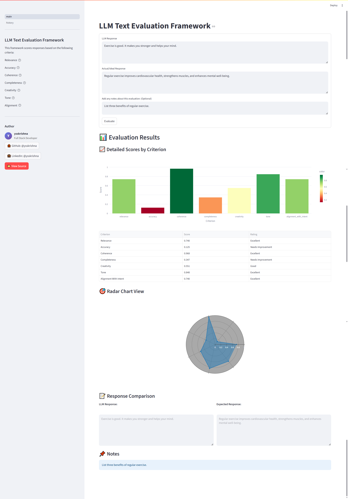
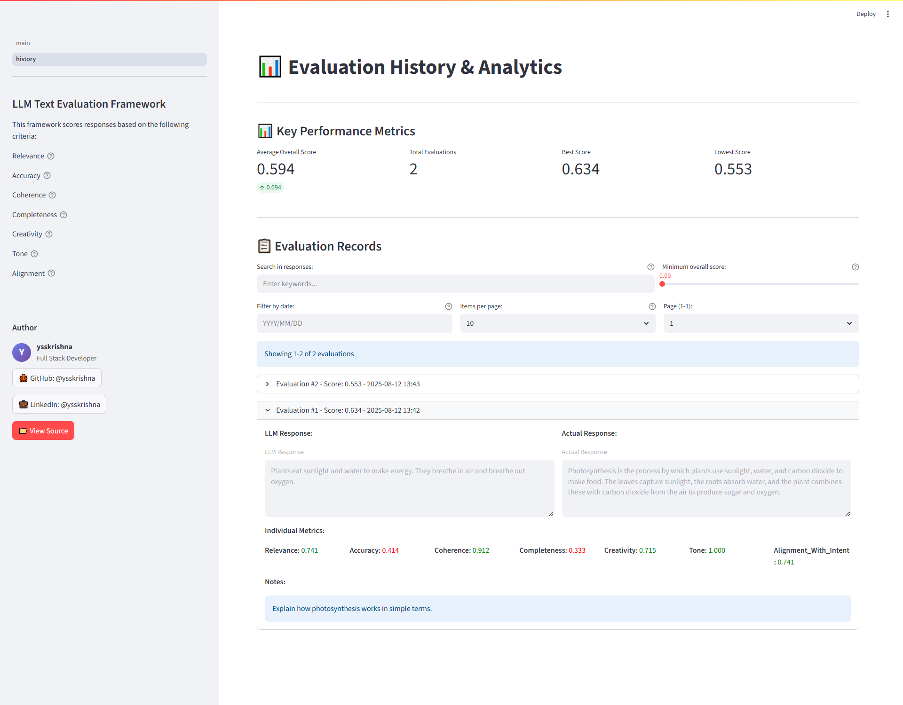

# LLM Text Evaluation Framework

[](https://www.python.org/downloads/)
[](https://streamlit.io/)
[](https://sqlmodel.tiangolo.com/)
[](https://www.nltk.org/)
[](https://www.sbert.net/)
[](https://docker.com/)
[](https://docs.astral.sh/uv/)
[](LICENSE)
[](https://github.com/ysskrishna/llm-text-evaluation-framework/releases)
[](https://ysskrishna.space)

A powerful, production-ready Streamlit web application for comprehensive LLM response evaluation and benchmarking. Features multi-dimensional scoring across 7 key criteria, interactive analytics dashboard, persistent evaluation history, and Docker deployment. Perfect for AI researchers, developers, and organizations seeking to systematically assess and improve their language model outputs with detailed metrics and visual insights.




## 📌 Features

### **Evaluation Metrics**

Scores responses across seven weighted criteria:

| Criteria         | Description                                                                         |
| ---------------- | ----------------------------------------------------------------------------------- |
| Relevance        | Measures how semantically similar the LLM response is to the expected response      |
| Accuracy         | Assesses the factual correctness and precision of the content                       |
| Completeness     | Evaluates the logical flow, readability, and sentence structure                     |
| Coherence        | Checks how well the response covers all expected content points                     |
| Creativity       | Measures originality and unique expression while maintaining relevance              |
| Tone             | Assesses appropriateness, consistency, and professional language use                |
| Intent Alignment | Evaluates how well the response matches the user's intended purpose                 |

## 🛠 Tech Stack

* **Python 3.10+**
* **Streamlit** (UI)
* **SQLite** (local storage)
* **Sentence Transformers** (semantic similarity)
* **NLTK & TextStat** (text quality analysis)
* **Plotly** (interactive charts)

## 🚀 Quick Start

### **Prerequisites**
- Python 3.10 or higher
- Docker (optional, for containerized deployment)
- UV package manager (recommended) or pip

### **1. Clone the Repository**

```bash
git clone https://github.com/ysskrishna/llm-text-evaluation-framework.git
cd llm-text-evaluation-framework
```

### **2.1 Run using Docker Compose (Recommended for Production)**
```bash
docker-compose up --build
```


### **2.2 Run using UV (Recommended for Development)**
```bash
# Install UV if you haven't already
pip install uv

# Install dependencies
uv sync

# Run the application
uv run streamlit run main.py
```


### **3. Open in Browser**

Visit **[http://localhost:8501](http://localhost:8501)**


## 📂 Project Structure

```
llm-text-evaluation-framework/
├── ai/                          # AI evaluation logic
│   ├── evaluator.py            # Main evaluation functions
│   └── evaluator_utils.py      # Utility functions for scoring algorithms
├── components/                  # Streamlit UI components
│   ├── evaluation_result.py    # Results display with charts and analytics
│   └── sidebar.py              # Sidebar navigation
├── core/                       # Core application logic
│   ├── config.py              # Configuration settings and weights
│   └── database.py            # Database initialization and setup
├── models/                     # Data models
│   ├── enums.py               # Evaluation criteria enums
│   └── models.py              # SQLModel data models
├── pages/                      # Streamlit pages
│   └── 1_history.py          # Evaluation history and analytics dashboard
├── repositories/               # Data access layer
│   └── evaluation.py          # Evaluation CRUD operations
├── main.py                     # Main application entry point
├── pyproject.toml             # Project configuration and dependencies
├── Dockerfile                  # Docker container configuration
├── docker-compose.yml          # Docker Compose setup
└── README.md                  # This file
```


## ⚙️ Configuration

### **Customizing Evaluation Weights**
Modify `core/config.py` to adjust scoring criteria weights:

```python
EVALUATION_CRITERIA_WEIGHTS = {
    EvaluationCriteria.RELEVANCE: 0.25,        # Increase relevance weight
    EvaluationCriteria.ACCURACY: 0.25,         # Increase accuracy weight
    EvaluationCriteria.COHERENCE: 0.15,        # Adjust as needed
    EvaluationCriteria.COMPLETENESS: 0.15,
    EvaluationCriteria.CREATIVITY: 0.05,
    EvaluationCriteria.TONE: 0.10,
    EvaluationCriteria.ALIGNMENT_WITH_INTENT: 0.05
}
```

### **Database Configuration**
SQLite database (`llm_evaluations.db`)


## 🚀 Future Enhancements
- [ ] **Export your results** - to Excel, CSV, or PDF reports
- [ ] **Batch testing** - evaluate hundreds of responses at once
- [ ] **Better analytics** - more charts and insights
- [ ] **Database Scalability** - Support PostgreSQL for large deployments
- [ ] **API access** - integrate with your own tools/workflow
- [ ] **Settings page** - for evaluation weights and settings via ui

## 🤝 Contributing

1. Fork the repository
2. Create a feature branch (`git checkout -b feature/amazing-feature`)
3. Commit your changes (`git commit -m 'Add amazing feature'`)
4. Push to the branch (`git push origin feature/amazing-feature`)
5. Open a Pull Request

## Built and maintained by

LLM Text Evaluation Framework is built and maintained by:

| | Name | GitHub | Role |
|---|------|--------|------|
|  | **Y. Siva Sai Krishna** | [@ysskrishna](https://github.com/ysskrishna) | Creator |

## Changelog

See [CHANGELOG](CHANGELOG.md) for release history.

## Support

If you find this project helpful:

- ⭐ Star the repository
- 🐛 [Report issues](https://github.com/ysskrishna/llm-text-evaluation-framework/issues)
- 🔀 Submit pull requests
- 💝 [Sponsor on GitHub](https://github.com/sponsors/ysskrishna)

## License

MIT © [Y. Siva Sai Krishna](https://github.com/ysskrishna) — see [LICENSE](LICENSE) for details.

---

<p align="left">
  <a href="https://github.com/ysskrishna">Author's GitHub</a> •
  <a href="https://linkedin.com/in/ysskrishna">Author's LinkedIn</a> •
  <a href="https://ysskrishna.space">Author's site</a> •
  <a href="https://github.com/ysskrishna/llm-text-evaluation-framework/issues">Report Issues</a>
</p>
